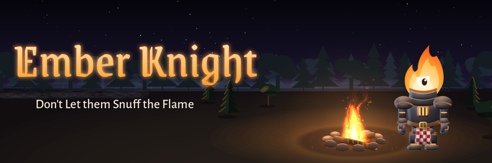

    

A tower defense / roguelike. You play as Char, the spirit of a campfire who defends his family without question.
 

Prevent increasingly difficult waves of enemies from putting out the campfire at night, and leaving the stagecoach in the dark. Build defenses, roll dice, and swear oaths to protect the fire.
  

## **Link to Play:** 

 
     https://wut-lab.github.io/Ember-Knight/ 

 
  

## **Running it**

Open the folder in **Godot 4.3** (or a newer 4.x) and press Play. The game works on both **PC and mobile**, with touch, mouse, keyboard and gamepad controls.
